# ERD and database relationship examples

These are illustrative models, not claims about Matomeru's current schema. An object type becomes an entity or table, and an object instance becomes a row.

## Reading the diagrams

The marker next to an entity says how many of that entity can relate to one entity at the other end.

| Marker | Meaning |
| --- | --- |
| `\|\|` | Exactly one |
| `o\|` or `\|o` | Zero or one |
| `o{` or `}o` | Zero or more |
| `\|{` or `}\|` | One or more |

`PK` means primary key, `FK` means foreign key, and `UK` means unique key. Multiple `PK` fields form one composite primary key.

A solid `--` line denotes an identifying relationship. A dashed `..` line
denotes a non-identifying relationship. This distinction is separate from
whether the relationship is required or optional.

## 1. One-to-one, required on both sides

Each agent has exactly one configuration, and each configuration belongs to exactly one agent.

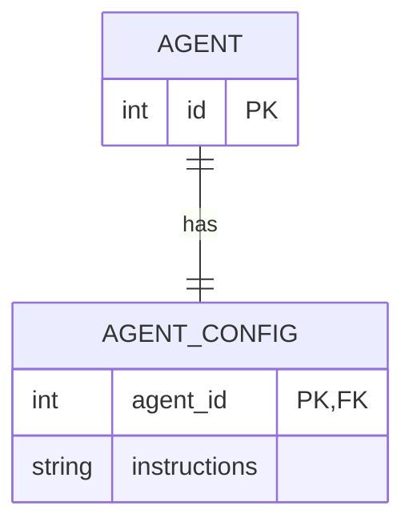

The shared primary key prevents multiple configurations per agent. The foreign key prevents an orphan configuration. Neither constraint requires every agent to have a configuration. That last rule needs additional enforcement, such as a deferred constraint trigger where supported, or a controlled transaction that creates both rows.

## 2. One-to-one, optional on one side

An agent may have no profile or one profile. Every profile belongs to exactly one agent.

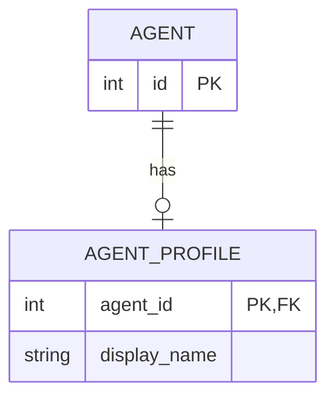

Unlike the previous example, an agent without a profile is valid.

## 3. One-to-one, optional on both sides

A pane can host at most one active AI session. An AI session can be attached to at most one pane. Either can exist unattached.

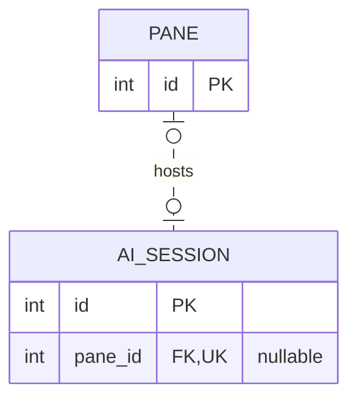

A nullable, unique foreign key represents this relationship. Use a unique index on non-null values if the database's handling of nulls requires it.

## 4. One-to-many, required parent

A project can have zero or more tasks. Each task belongs to exactly one project.

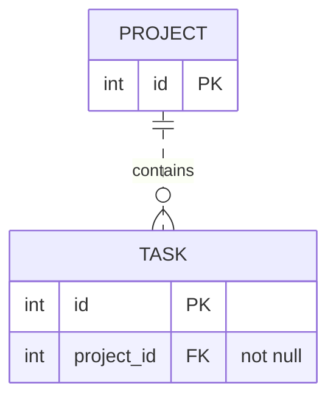

Many-to-one is this same relationship viewed from the task. It is not another storage pattern.

## 5. One-to-many, optional parent

A project can have zero or more tasks. Each task belongs to zero or one project, so an inbox task can be unassigned.

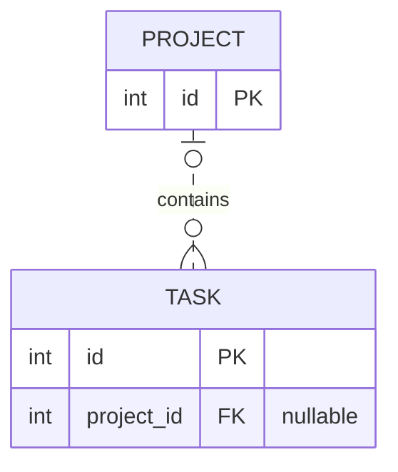

For example, `{ id: 7, project_id: null }` is an unassigned task, while `{ id: 8, project_id: 2 }` belongs to project 2.

## 6. One-to-many, at least one child

A saved workflow must contain one or more steps. Every step belongs to exactly one workflow.

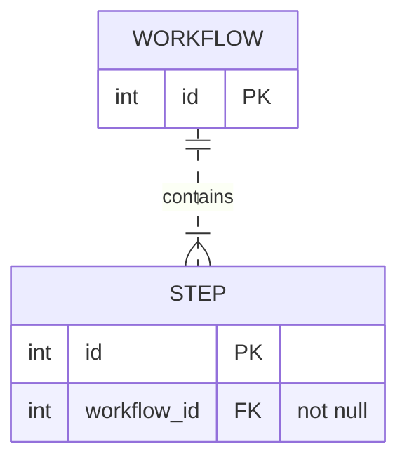

The foreign key checks each step's workflow, not whether every workflow has a step. The minimum-child rule requires additional enforcement.

## 7. Many-to-many, through a join table

An agent can use many skills, and a skill can be used by many agents. Both may exist without any assignments.

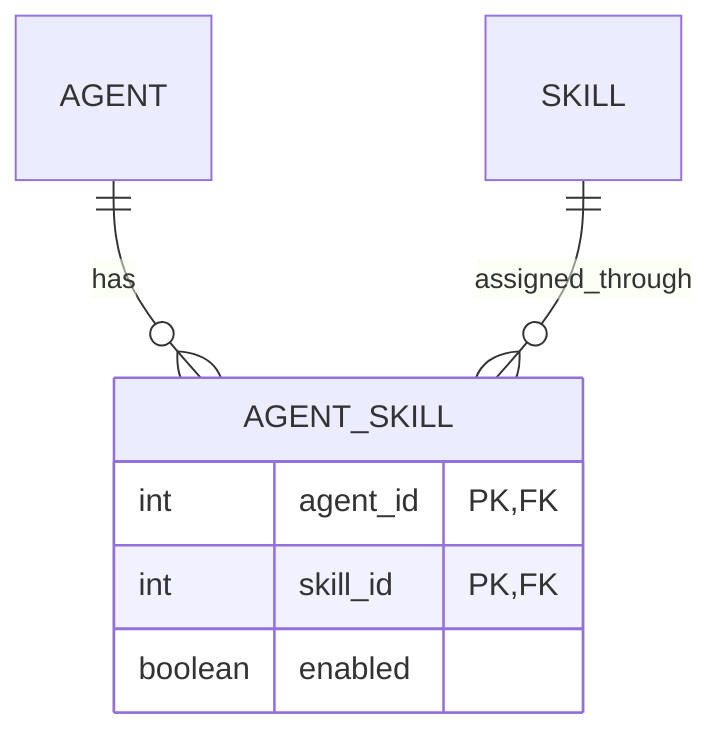

The join table turns many-to-many into two one-to-many relationships. Its composite primary key prevents duplicate assignments. Relationship-specific data, such as `enabled`, belongs on the join row.

For example, `{ agent_id: 3, skill_id: 9, enabled: true }` assigns skill 9 to agent 3.

## 8. Self-referencing one-to-many, a hierarchy

A task may have one parent task and many subtasks. A root task has no parent.

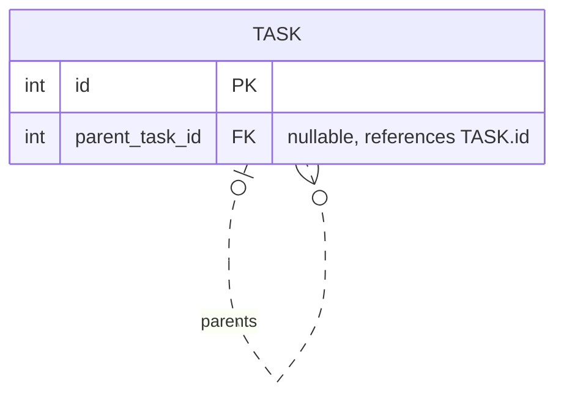

A foreign key alone does not prevent a task from parenting itself or creating a cycle. A tree or forest needs those additional rules.

## 9. Self-referencing many-to-many, a graph

A commit can have multiple parents, as in a merge. A commit can also be the parent of multiple later commits.

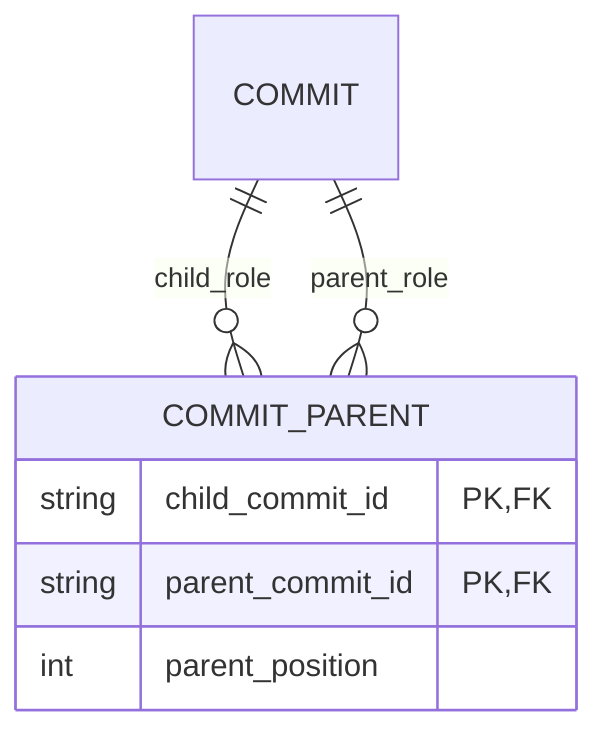

The two foreign keys reference the same table but have different roles. Store parent order if Git's first-parent semantics matter. Foreign keys do not enforce an acyclic graph.

## 10. Identifying versus non-identifying

An identifying relationship makes the parent's key part of the child's primary key. A non-identifying relationship gives the child an independent primary key.

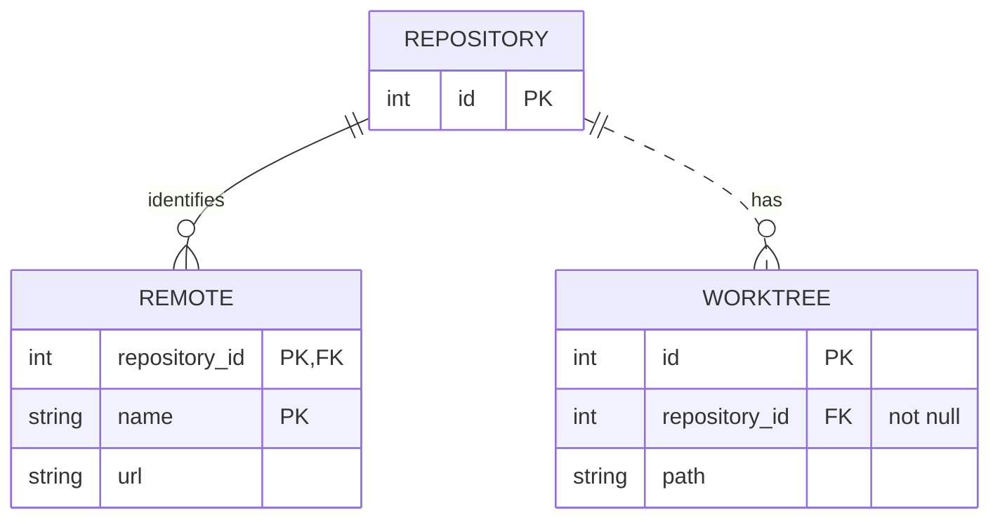

A remote's identity is the pair `{ repository_id: 2, name: "origin" }`. A worktree's identity is its own `id`. Required foreign keys do not automatically make a relationship identifying.

## 11. Multiple relationships between the same types

A task has a creator and may have an assignee. Both roles reference agents, but they are distinct relationships.

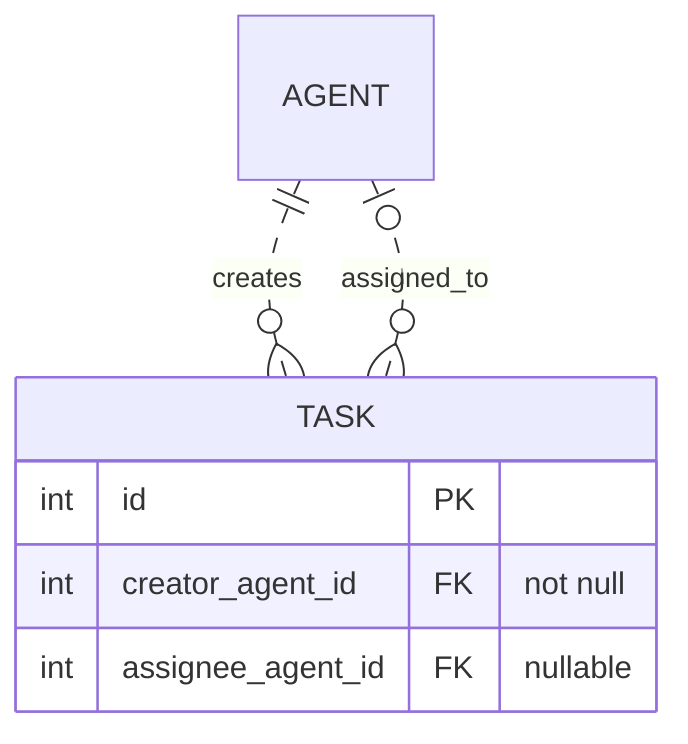

The creator and assignee may be the same agent unless a separate rule forbids it.

## 12. Ternary relationship, three participants at once

An agent receives a role within a project. The fact concerns the combination of all three participants.

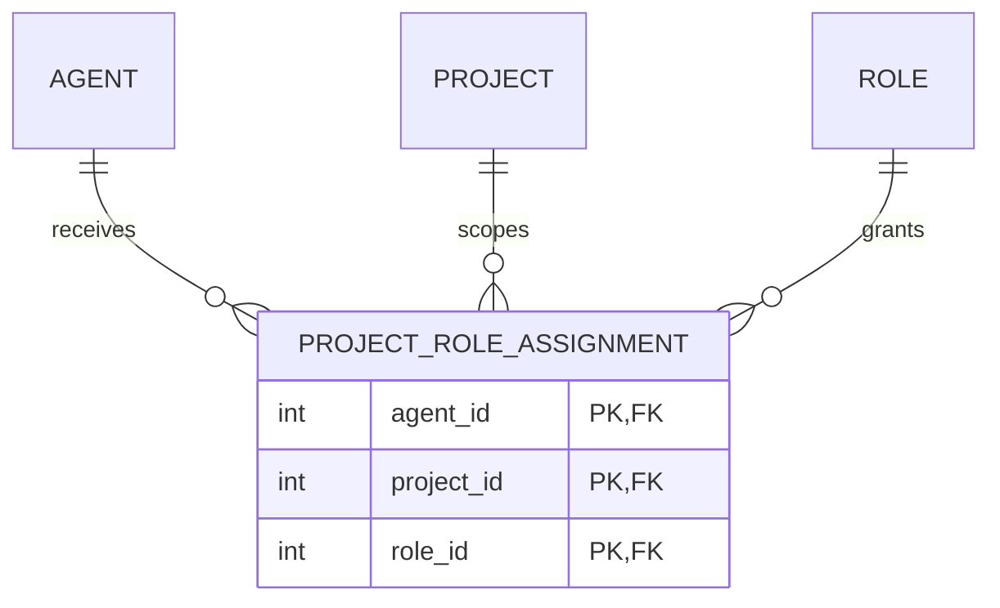

For example, `{ agent_id: 3, project_id: 2, role_id: 5 }` gives agent 3 role 5 in project 2. Three independent pairwise relationships would lose which role applies in which project. More participants use the same association-table pattern.

## 13. Supertype and subtype, an "is-a" relationship

Local agents and remote agents share an agent identity, but each subtype has different fields.

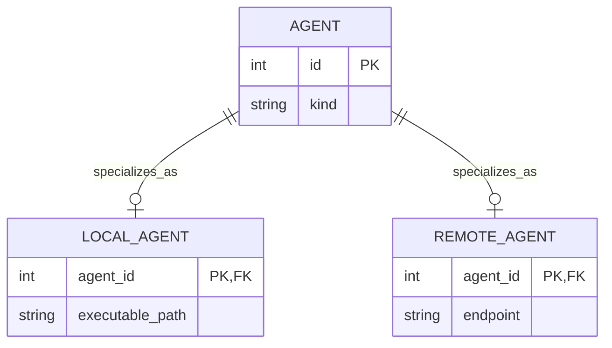

These foreign keys allow an agent to have neither subtype, either subtype, or both. If every agent must have exactly one subtype, enforce that separately. Mermaid ER diagrams do not express that exclusive, exhaustive choice directly.

## 14. Polymorphic target, an "either type" relationship

A note belongs to either a project or a task. Two real foreign keys preserve database referential integrity.

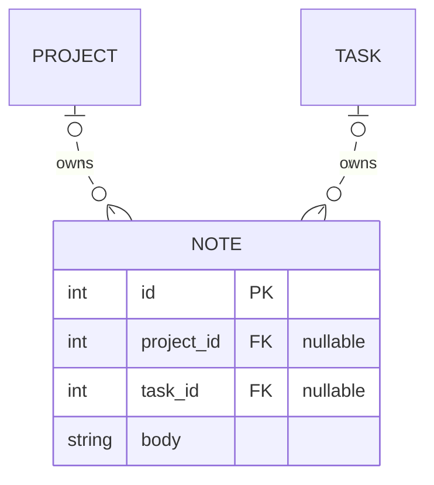

Add a check constraint requiring exactly one target:

```sql
CHECK (
	(project_id IS NOT NULL AND task_id IS NULL)
	OR (project_id IS NULL AND task_id IS NOT NULL)
)
```

A generic `{ target_type: "task", target_id: 7 }` is another common design, but a normal foreign key cannot switch target tables using `target_type`.

## Cardinality is separate from ownership and storage

The cardinality markers can be combined independently at either end. For example, many-to-many can require at least one link on either side rather than allowing zero. Such minimum-link rules need enforcement beyond ordinary foreign keys.

Composition means a child belongs to an owner's lifecycle. Aggregation means a looser grouping of independently existing objects. These are object-model semantics, not extra ERD cardinalities. A foreign key with `ON DELETE CASCADE` can implement owned-child deletion. `RESTRICT` or `NO ACTION` prevents deletion while references remain, subject to the database's checking rules. `SET NULL` detaches a child when its foreign key is nullable. Mermaid's solid line does not mean cascade deletion.

A document database may embed children inside a parent document or reference separate documents. Embedding is a storage choice, not a new cardinality. Similarly, an indirect relationship reached through joins is a query path, not necessarily another stored foreign key.
